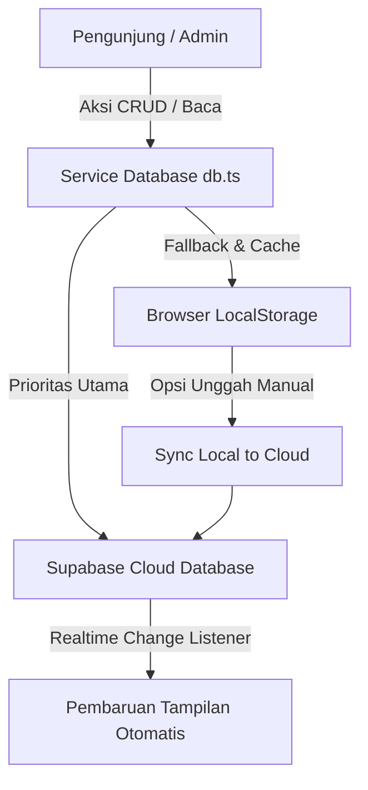

<div align="center">

# 🌿 Pesona Banaran (Pesona Bleberan)
### Portal Resmi Ekowisata Bahari, Konservasi Mangrove & UMKM Dusun Bleberan
**Kalurahan Banaran, Kapanewon Galur, Kabupaten Kulon Progo, D.I. Yogyakarta**

[](https://vitejs.dev/)
[](https://react.dev/)
[](https://www.typescriptlang.org/)
[](https://tailwindcss.com/)
[](https://supabase.com/)
[](https://ai.google.dev/)

---

<p align="center">
  Sebuah inisiatif digitalisasi desa dan promosi potensi lokal yang dikembangkan oleh <b>KKN UII Angkatan 72 Dusun Bleberan</b> untuk mengangkat kekayaan alam pesisir selatan Kulon Progo, konservasi Kawasan Ekosistem Esensial (KEE), wisata air hilir Progo, dan pemberdayaan produk UMKM lokal.
</p>

</div>

---

## 📑 Daftar Isi

- [Tentang Proyek](#-tentang-proyek)
- [Fitur Utama](#-fitur-utama)
- [Teknologi yang Digunakan](#-teknologi-yang-digunakan)
- [Struktur Direktori](#-struktur-direktori)
- [Prasyarat Sistem](#-prasyarat-sistem)
- [Panduan Instalasi & Menjalankan Proyek](#-panduan-instalasi--menjalankan-proyek)
- [Konfigurasi Environment](#-konfigurasi-environment)
- [Panduan Portal Administrator](#-panduan-portal-administrator)
- [Arsitektur Data & Sinkronisasi](#-arsitektur-data--sinkronisasi)
- [Tim Pengembang](#-tim-pengembang)
- [Lisensi & Hak Cipta](#-lisensi--hak-cipta)

---

## 📖 Tentang Proyek

**Pesona Banaran** adalah platform web interaktif yang dirancang khusus untuk memperkenalkan dan mempromosikan potensi pariwisata serta keanekaragaman hayati di **Dusun Bleberan, Kalurahan Banaran, Kapanewon Galur, Kabupaten Kulon Progo, Daerah Istimewa Yogyakarta**.

Terletak strategis di pertemuan muara Sungai Progo dan Samudra Hindia, kawasan ini memiliki nilai ekologis yang sangat tinggi sebagai bagian dari **Kawasan Ekosistem Esensial (KEE)** pesisir, koridor singgah (*stopover*) burung migran lintas benua (jalur *East Asian-Australasian Flyway*), serta benteng alami pencegah abrasi melalui Hutan Mangrove Wanatirta.

Platform ini hadir sebagai solusi *Smart Tourism* berbasis web yang memadukan promosi pariwisata ramah lingkungan, katalog UMKM warga dengan integrasi WhatsApp langsung, asisten virtual bertenaga **Google Gemini AI**, serta sistem pengelolaan konten (CMS) mandiri yang mudah digunakan oleh pengurus dusun.

---

## ✨ Fitur Utama

### 1. 🌊 Eksplorasi Destinasi & Wisata Air
- **Katalog Wisata Lengkap**: Menampilkan destinasi unggulan seperti Hutan Mangrove Wanatirta, Susur Sungai Kabanaran menuju jembatan ikonik, hingga Camping Ground tepi sungai.
- **Halaman Detail Interaktif**: Informasi mendalam mencakup galeri foto (*carousel/grid*), jam kunjungan terbaik (*golden hour*), tarif tiket/sewa, fasilitas, serta tips keselamatan pengunjung.

### 2. 🛍️ Direktori UMKM Lokal
- **Etalase Produk Desa**: Menampilkan produk khas warga Bleberan seperti Jadah Gurih Bleberan, Peyek Udang & Ikan Wader segar hasil tangkapan muara.
- **Direct Order WhatsApp**: Pengunjung dapat langsung terhubung ke kontak WhatsApp masing-masing pelaku usaha untuk melakukan pemesanan.

### 3. 🦅 Konservasi KEE & Burung Migran
- **Edukasi Burung Migran**: Direktori spesies burung pantai dan burung migran (misal: Cerek Jawa / *Charadrius javanicus*, Kedidi, Trinil) yang singgah di muara Trisik-Banaran.
- **Etika & Panduan Pengamatan**: Tips observasi burung (*birdwatching*) yang ramah lingkungan (menjaga jarak aman, bebas sampah plastik, tidak memberi makan sembarangan, dan menjaga ketenangan).

### 4. 🌿 Edukasi Ekosistem Mangrove
- **Zonasi & Spesies Pohon**: Pemaparan jenis tanaman mangrove (*Rhizophora*, *Avicennia*, *Sonneratia*, *Bruguiera*) beserta perannya dalam penyerapan karbon biru (*blue carbon*) dan perlindungan abrasi.

### 5. 📅 Kegiatan Komunitas & Agenda Desa
- **Showcase Event**: Publikasi agenda warga seperti Festival Mangrove tahunan, aksi bersih muara, dan kegiatan kemasyarakatan lainnya lengkap dengan dokumentasi galeri.

### 6. 🤖 Asisten Virtual Cerdas (AI Smart Tourism)
- **Tanya Jawab 24/7**: Didukung oleh **Google Gemini API**, bertindak sebagai "Guide Bleberan" virtual yang siap menjawab pertanyaan seputar paket wisata, waktu kunjungan, rute perjalanan, hingga kuliner lokal secara otomatis dan interaktif.

### 7. 🔐 Portal Administrator & CMS Mandiri
- **Manajemen Konten Dinamis**: Kelola data destinasi wisata, UMKM, burung migran, kegiatan masyarakat, dan konfigurasi kontak situs secara instan melalui UI dashboard yang modern.
- **Upload Gambar Fleksibel**: Mendukung unggahan gambar lokal langsung (otomatis dikonversi ke *Data URL* dengan kompresi aman) maupun tautan URL eksternal.
- **Realtime Database**: Menggunakan **Supabase** dengan sinkronisasi otomatis (*cloud-first*) dan fallback ke *LocalStorage* jika koneksi terputus.

---

## 🛠️ Teknologi yang Digunakan

| Kategori | Teknologi / Pustaka | Keterangan |
| :--- | :--- | :--- |
| **Frontend Framework** | [React 19](https://react.dev/) | Library UI modern performa tinggi |
| **Bahasa Pemrograman** | [TypeScript](https://www.typescriptlang.org/) | Pengetikan statis untuk keamanan kode |
| **Build Tool & Bundler** | [Vite 6](https://vitejs.dev/) | Tooling frontend kilat dengan HMR instan |
| **Styling & Tampilan** | [Tailwind CSS](https://tailwindcss.com/) | Utilitas styling responsif & modern |
| **Typography** | Plus Jakarta Sans & Playfair Display | Tipografi elegan dari Google Fonts |
| **Database & Realtime** | [Supabase](https://supabase.com/) | PostgreSQL backend dengan live subscription |
| **Kecerdasan Buatan** | [Google Gen AI SDK](https://github.com/google-gemini/generative-ai-js) | Integrasi model Gemini untuk chatbot pemandu |
| **Efek Animasi** | React Typed & Custom CSS Animations | Efek teks mengetik dan transisi halus |

---

## 📁 Struktur Direktori

```text
pesona-banaran/
├── components/                     # Komponen antarmuka React
│   ├── AIChat.tsx                  # Widget chat pemandu wisata virtual bertenaga Gemini
│   ├── ActivityDetailView.tsx      # Tampilan detail kegiatan komunitas & festival
│   ├── AdminDashboard.tsx          # Panel dashboard CMS pengelolaan konten
│   ├── AdminPanel.tsx              # Komponen pendukung panel admin
│   ├── Attractions.tsx             # Seksi daftar destinasi ekowisata utama
│   ├── BirdMigration.tsx           # Seksi edukasi burung migran & tips konservasi
│   ├── CommunityActivities.tsx     # Seksi agenda & kegiatan masyarakat dusun
│   ├── DestinationDetailView.tsx   # Tampilan detail lengkap destinasi wisata
│   ├── Hero.tsx                    # Banner utama hero section beranda
│   ├── LocationSection.tsx         # Peta interaktif & petunjuk lokasi Dusun Bleberan
│   ├── Login.tsx                   # Modal / halaman login otentikasi pengurus
│   ├── MangroveDetailView.tsx      # Halaman detail edukasi ekosistem mangrove
│   ├── MangroveEducation.tsx       # Seksi ringkasan edukasi mangrove
│   ├── Navbar.tsx                  # Navigasi utama situs (responsif)
│   ├── UMKM.tsx                    # Komponen daftar UMKM
│   ├── UMKMDetailView.tsx          # Tampilan detail produk UMKM & kontak pesan
│   └── UMKMSection.tsx             # Seksi katalog UMKM di beranda
├── logo/                           # Aset visual & logo identitas dusun
│   ├── bleberan.png                # Logo resmi Dusun Bleberan
│   └── bleberan2.png               # Varian logo alternatif
├── services/                       # Lapisan integrasi data & API eksternal
│   ├── db.ts                       # Klien Supabase, skema data & fallback LocalStorage
│   └── gemini.ts                   # Integrasi Google Gemini API & Maps Grounding
├── App.tsx                         # Komponen induk aplikasi & manajemen navigasi
├── content.ts                      # Data awal (fallback initial content)
├── index.css                       # Styling global
├── index.html                      # Entry point HTML & importmap
├── index.tsx                       # Titik masuk React DOM rendering
├── metadata.json                   # Metadata konfigurasi aplikasi
├── package.json                    # Konfigurasi dependensi dan skrip proyek
├── tsconfig.json                   # Konfigurasi kompilasi TypeScript
├── types.ts                        # Definisi antarmuka & tipe data TypeScript
├── vite.config.ts                  # Konfigurasi build & dev server Vite
└── .env.local                      # Konfigurasi environment variables lokal
```

---

## 💻 Prasyarat Sistem

Sebelum menjalankan proyek di komputer lokal Anda, pastikan telah menginstal:
- **Node.js** (versi 18.x atau 20.x ke atas disarankan)
- **npm** (biasanya terpasang otomatis bersama Node.js) atau **yarn** / **pnpm**
- Koneksi internet (untuk akses Supabase Cloud dan Google Gemini API)

---

## 🚀 Panduan Instalasi & Menjalankan Proyek

Ikuti langkah-langkah berikut untuk menjalankan proyek di komputer lokal:

### 1. Kloning Repositori
```bash
git clone https://github.com/FbritamaRK/bleberanWebsite.git
cd bleberanWebsite
```

### 2. Pasang Dependensi
```bash
npm install
```

### 3. Konfigurasi Environment Variable
Salin berkas konfigurasi lingkungan atau buat berkas `.env.local` pada direktori *root*:
```env
GEMINI_API_KEY=masukkan_api_key_google_gemini_anda
```

> 💡 **Cara Mendapatkan Gemini API Key:**
> Anda dapat memperoleh kunci API gratis melalui [Google AI Studio](https://aistudio.google.com/).

### 4. Jalankan Server Development
```bash
npm run dev
```
Setelah server berjalan, buka browser dan akses alamat berikut:
```text
http://localhost:3000
```

### 5. Membangun Proyek untuk Produksi
Jika ingin melakukan kompilasi bundel produksi:
```bash
npm run build
```
Untuk menguji hasil build secara lokal:
```bash
npm run preview
```

---

## 🔐 Panduan Portal Administrator

Situs ini dilengkapi dengan portal admin terpadu untuk memudahkan perangkat dusun mengelola data tanpa perlu mengubah kode sumber:

1. **Akses Portal**:
   - Scroll ke bagian paling bawah beranda (footer).
   - Klik tombol **"🔐 Kelola Konten"** pada bagian *Admin Portal*.
   - Atau klik tautan admin melalui navbar jika tersedia.
2. **Kredensial Akses**:
   - Masukkan kata sandi administrator (default): `bleberan2026`
3. **Fitur yang Tersedia di Dashboard**:
   - **Kelola Wisata**: Tambah, ubah deskripsi, atur harga tiket, jadwal terbaik, serta galeri foto destinasi.
   - **Kelola UMKM**: Tambah produk warga, harga, nomor WhatsApp pemilik, dan foto produk.
   - **Kelola Biodiversitas / Burung**: Dokumentasi satwa muara, nama ilmiah, status konservasi, dan foto.
   - **Kelola Kegiatan Komunitas**: Publikasi festival dusun dan dokumentasi aktivitas warga.
   - **Pengaturan Kontak & Logo**: Ubah nomor kontak dusun, alamat, email, serta logo situs.
   - **Sync to Cloud**: Tombol sinkronisasi manual untuk memastikan semua data lokal tersinkron ke Supabase Cloud.

---

## 🔄 Arsitektur Data & Sinkronisasi

Aplikasi ini menggunakan pola **Hybrid Cloud-First with Local Fallback**:



- **Cloud Database**: Menggunakan **Supabase** tabel `attractions`, `umkm`, `birds`, dan `settings`.
- **Live Updates**: Memanfaatkan Supabase Realtime Channel (`schema-db-changes`) sehingga jika ada perubahan data dari admin, pengunjung lain akan langsung melihat pembaruan tanpa perlu merefresh halaman secara manual.
- **Offline Resiliency**: Jika jaringan internet tidak stabil atau kuota database habis, sistem secara otomatis beralih ke data *LocalStorage* dan nilai awal (*initial content*) sehingga situs tetap dapat diakses dengan lancar.

---

## 👥 Tim Pengembang

Proyek ini disusun dan dikembangkan sebagai bagian dari luaran program pengabdian masyarakat:

* **Program**: Kulon Progo - KKN Reguler Angkatan 72 Universitas Islam Indonesia (UII)
* **Lokasi Pengabdian**: Dusun Bleberan, Kalurahan Banaran, Kapanewon Galur, Kabupaten Kulon Progo, D.I. Yogyakarta
* **Pengembang**: Mahasiswa KKN UII 72 Dusun Bleberan (NIM: 22523258 / Tim KKN)
* **Tahun Pelaksanaan**: 2026

---

## 📄 Lisensi & Hak Cipta

Hak Cipta &copy; 2026 **Pemerintah Kalurahan Banaran, Pengurus Dusun Bleberan, dan Tim KKN UII 72**.  
Dikembangkan untuk kepentingan promosi, edukasi lingkungan, dan kemakmuran masyarakat Dusun Bleberan, Galur, Kulon Progo.
